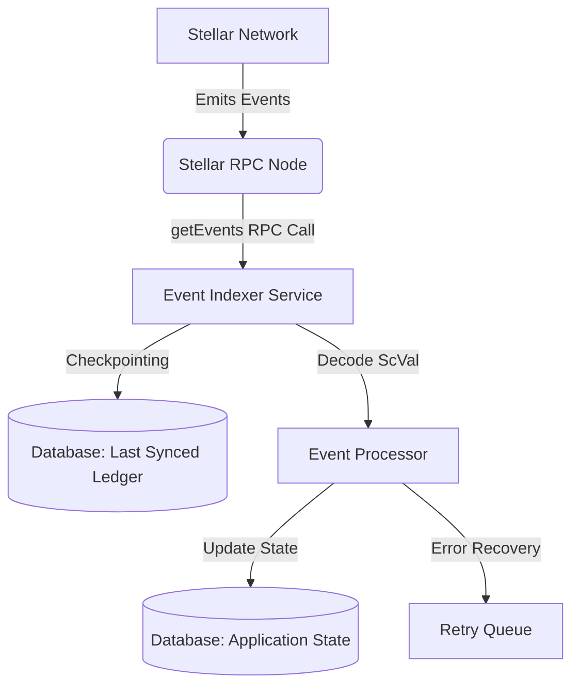

# Soroban Event Indexer Architecture

## Overview

The Soroban Event Indexer is a critical background service that keeps the off-chain database synchronized with on-chain Soroban contract states. It polls the Stellar RPC node for emitted events, decodes the `ScVal` data, and updates the local database accordingly.

### Architecture Diagram

## Event Topic Structures

The indexer filters and listens to specific topics from various smart contracts.

The background indexer is started when `SOROBAN_INDEXER_CONTRACT_IDS` is set to
a comma-separated list of contract IDs. It paginates each RPC response and
stores each RPC event ID in `soroban_event_logs` and the RPC high-water ledger
in `soroban_indexer_checkpoints`, including ledgers without matching events.
Failed state updates remain unprocessed and are retried from their ledger on the next poll. Configure the
RPC endpoint with `STELLAR_RPC_URL` (or `SOROBAN_RPC_URL`).

### Investor events

The event topic name is the first decoded topic. Investor event values can be
encoded as named fields in the event data or as positional topics after the
topic name. The indexer accepts camelCase or snake_case field names:

- `OnboardingBonusClaimed`: `wallet`, `bonus_amount`, `invoice_id`, and
  optionally `claimed_at`. The timestamp falls back to the ledger close time.
- `AlertPreferenceUpdated`: `wallet` and preference booleans for
  `settlement`, `kyc_expiry`, `watchlist_change`, `auto_invest`, and `maturity`.
  Omitted settings remain enabled by default.
- Settlement events: `invoice_id`, `adjustment_bps`, `basis_rating`, and
  `adjusted_yield`. An omitted bps value is recorded as zero when rating/yield
  adjustment data is present.

The onboarding pool admin endpoint reads the persistent contract-data key
configured by `ONBOARDING_BONUS_POOL_STORAGE_KEY` (default `pool_balance`) from
`ONBOARDING_BONUS_CONTRACT_ID`. Alert dispatch posts one JSON request per opted-in
wallet to `NOTIFICATION_SERVICE_URL` with `wallet`, `event_type`, and event
metadata; each request includes an `idempotency-key`. A bearer token can be
configured with `NOTIFICATION_SERVICE_TOKEN`. Dispatch failures leave the event
unprocessed so the indexer can retry it.

Investor wallet endpoints are authenticated and only return data for the
authenticated wallet. Yield-adjustment reads are available without wallet
authentication:

- `GET /api/v1/investors/:wallet/onboarding-bonus`
- `GET /api/v1/investors/:wallet/alert-preferences`
- `GET /api/v1/invoices/:invoice_id/yield-adjustment`
- `GET /api/v1/invoices/:invoice_id/yield-adjustment/history`
- `GET /api/v1/admin/onboarding-bonus/pool-balance` (admin IP allowlist)

### 1. Invoice Escrow Contract (`invoice-escrow`)
Topics emitted during the escrow lifecycle:
- `["escrow", "initialized"]`: Triggered when a new invoice is escrowed.
  - Data: `Invoice ID`, `Amount`, `Payer`, `Payee`
- `["escrow", "released"]`: Triggered when funds are released to the payee.
  - Data: `Invoice ID`, `Transaction Hash`
- `["escrow", "refunded"]`: Triggered when funds are returned to the payer.
  - Data: `Invoice ID`, `Reason`

### 2. Invoice Token Contract (`invoice-token`)
Topics emitted for tokenized invoices:
- `["token", "minted"]`: Triggered when invoice tokens are minted.
  - Data: `Token ID`, `Amount`, `Owner`
- `["token", "transferred"]`: Triggered on token transfer.
  - Data: `Token ID`, `From`, `To`, `Amount`
- `["token", "burned"]`: Triggered when tokens are burned upon settlement.
  - Data: `Token ID`, `Amount`

### 3. Payment Distributor Contract (`payment-distributor`)
Topics related to distributing yields or payments:
- `["payment", "distributed"]`: Triggered when a batch of payments is distributed.
  - Data: `Batch ID`, `Total Amount`, `Recipients Count`
- `["payment", "failed"]`: Triggered when a specific payment fails.
  - Data: `Recipient`, `Amount`, `Error Code`

## Last-Synced Ledger Checkpointing

To ensure no events are missed and to prevent processing duplicate events, the indexer relies on a checkpointing mechanism:

1. **Polling**: The indexer queries the RPC `getEvents` endpoint using a ledger range (e.g., `startLedger` to `endLedger`).
2. **Checkpointing**: After successfully processing all events up to `endLedger`, the indexer saves `endLedger` to the database as the `last_synced_ledger`.
3. **Resume**: On restart, the indexer queries the database for `last_synced_ledger` and resumes polling from `last_synced_ledger + 1`.

## Failure Recovery Procedures

The indexer is designed to handle temporary failures and RPC limits:

- **RPC Rate Limiting**: If a `429 Too Many Requests` error occurs, the indexer applies exponential backoff before retrying the `getEvents` call.
- **Ledger Gap Recovery**: If the `startLedger` is too far behind (e.g., beyond the RPC node's retention window), the system alerts administrators for manual intervention or falls back to an archive node.
- **Processing Failures**: If event decoding or database updates fail for a specific event, the indexer logs the error, places the event in a Dead Letter Queue (DLQ) for manual inspection, and continues processing subsequent events to avoid blocking the pipeline.
